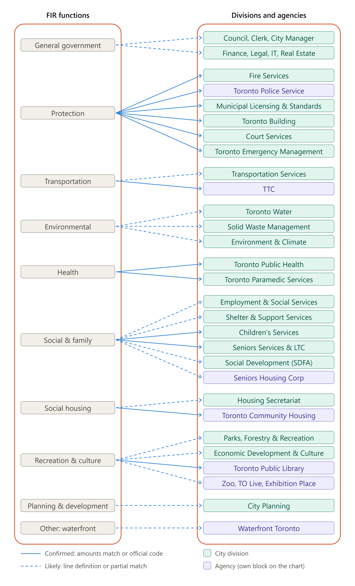

# Adding Toronto's finances

This is the Toronto-specific guide under [Adding financial data](adding-data.md). Read that page first for the account, access and importer setup. This page covers the part that is specific to Toronto: where the numbers live, how to read them, and how to turn them into a clean list of transactions.


**Status:** this guide is new and is being tested on Toronto's 2025 data. The sample numbers below are real lines from the source, shown so you can see what a finished row looks like. They are not a promise that a year is already loaded. Check the chart (and the Budget Category list) before you start. If a step doesn't match what you see, tell us.


## The goal: a list of transactions

Your job is to produce one simple list. Every row answers five questions:

| Question | Column | Example |
|---|---|---|
| Where is the money coming from? | `From` | The City's treasury account |
| Where is it going? | `Budget_Category` | Children's Services → Contracted Services |
| How much? | `Amount` | 1,086,284,138 |
| When? | `Date` | 2025-12-31 (last day of the fiscal year) |
| How do we know? | `Description` | Names the source, the line code and the column |

You are not analysing anything. You are copying numbers from a published document into rows, and putting each row in the right box. The chart does the rest.

## A sample you can copy

This is Toronto's **Children's Services** for 2025, taken from one line of the Province's Financial Information Return (FIR). The source line is Schedule 40, line **1230** *Child Care and Early Years Learning*. The source total (column N, *Total Expenses Before Adjustments*) is **$1,233,279,020**, and it is split across the seven spending columns, G to M.

| Transaction_Number | Amount | Currency | Date | From | Budget_Category | Description |
|---|---|---|---|---|---|---|
| TXN-SFS-101 | 135276150 | CAD | 2025-12-31 | *treasury account* | SFS-101 | Children's Services — Salaries and Benefits, 2025 actual. FIR Schedule 40 line 1230 (Child Care and Early Years Learning), Salaries and Benefits column, Total Expenses Before Adjustments. |
| TXN-SFS-102 | 50400 | CAD | 2025-12-31 | *treasury account* | SFS-102 | … Interest on Long Term Debt column … |
| TXN-SFS-103 | 7537722 | CAD | 2025-12-31 | *treasury account* | SFS-103 | … Materials column … |
| TXN-SFS-104 | 1086284138 | CAD | 2025-12-31 | *treasury account* | SFS-104 | … Contracted Services column … |
| TXN-SFS-105 | 3196328 | CAD | 2025-12-31 | *treasury account* | SFS-105 | … Rents & Financial column … |
| TXN-SFS-106 | 868 | CAD | 2025-12-31 | *treasury account* | SFS-106 | … External Transfers column … |
| TXN-SFS-107 | 933414 | CAD | 2025-12-31 | *treasury account* | SFS-107 | … Amortization column … |

The seven amounts add up to $1,233,279,020, exactly the source total. That check is how you know you copied correctly.

The importer expects a few more columns (`Legal_Basis`, `Item`), which you leave blank unless a source gives you the answer. The `From` value is the ID of the City's treasury account in Corteza. Your task's README gives you the right one, so don't look it up yourself. A complete working example, with both CSV files, is in the importer's [`examples/children-services-2024`](https://github.com/democracydistributed/docs/tree/main/tools/corteza-csv-importer/examples/children-services-2024) folder.

## Where does each line go?

The FIR groups spending by **function** (for example *Social and Family Services*). The chart groups it by **division** (for example *Children's Services*). Before you can put a row in a box, you need to know which division a function line belongs to.

- **Solid line:** confirmed. The amounts match, or an official code ties them together.
- **Dashed line:** likely. Based on the line's definition or a partial match, but not proven.
- **Green box:** a City division. **Purple box:** an agency, which gets its own block on the chart (TTC, Toronto Police Service, Toronto Public Library and so on).

The picture is the summary. The full line-by-line mapping (every FIR code, its Budget Category number and its status) is a spreadsheet kept with the Toronto research files. Ask for the current copy before you start.


**If the line isn't a solid arrow, leave `Department` blank.** Set it only when a source links the line to that division. A blank is useful information. A guess isn't.


## Reading the FIR spreadsheet

1. Open the Toronto FIR workbook (see Sources below). Each sheet is a numbered schedule. You mostly need two:
   - **Sheet `40`**: money going **out** (expenses), by function line and by type of spending.
   - **Sheet `10`**: money coming **in** (revenue).
2. On sheet 40, find your line by its **four-digit code** in column C (for example `1230`).
3. Copy the amounts from the seven spending columns, **G to M**:

   | G | H | I | J | K | L | M | N |
   |---|---|---|---|---|---|---|---|
   | Salaries | Interest on debt | Materials | Contracted services | Rents & financial | External transfers | Amortization | **Total** |

4. Check that G to M add up to N. If they don't, stop and report it.
5. **Skip the "Subtotal" rows** (codes ending in 99, such as `1299`). Adding them as well as their lines would count the money twice.
6. Ignore columns P to R (adjustments). We use column N, *Total Expenses Before Adjustments*.

Some real-world quirks you'll meet:

- **Negative numbers are real.** On sheet 40, Transit's External Transfers (line `0631`) is **−14,285,844**. Copy it as it is, with the minus sign.
- **Blank or zero lines** (for example `0612` Roads - Unpaved) don't need a row. No money, no transaction.
- **Amounts are in full dollars.** The sheet already shows them that way. Don't round or convert to millions.

### Money coming in

Revenue works the same way, from sheet `10`, using the *Own Purposes Revenue* column (J). A few real lines from 2025, to show what you're looking for:

| Code | Line | Amount (CAD) |
|---|---|---|
| 0299 | Taxation – Own Purposes | 6,122,419,947 |
| 0499 | Payments-In-Lieu of Taxation | 115,524,158 |
| 0810 | Ontario Conditional Grants | 3,066,518,618 |
| 0820 | Canada Conditional Grants | 1,074,127,323 |

The property tax categories already exist in Corteza, so export the Budget Category list and look there before creating anything. If a revenue line has no category yet, ask in Slack before you invent one.

## Make your list

1. **Pick one function line** (one source row) and ask what's open, so two people don't do the same work.
2. **Check what already exists.** Export the Budget Category list and search for your category numbers. Look at the chart for that year too. If the branch is already loaded, don't load it again.
3. **Build the rows** in a spreadsheet with the columns above. One row per spending column that has a non-zero amount.
4. **Write a description you'd trust.** It should name the source, the line code and the column, so a stranger can check the number in under a minute.
5. **Check the total.** Your rows should add up to the source line exactly.
6. **Load it.** Save as CSV and follow the bulk importer steps on the [parent page](adding-data.md#using-the-bulk-importer). Always dry-run first.

## Sources

Everything we enter must come from a published document you can name.

| Source | What it's for | Link |
|---|---|---|
| **Ontario FIR, 2025** (Financial Information Return) | The main source. The Province's standard report, with Toronto's spending and revenue by function. Schedule 40 for expenses, Schedule 10 for revenue. | [Ontario FIR site](https://efis.fma.csc.gov.on.ca/fir/index.php/en/year-municipality/year-2025-2-2-2-2-2/) |
| **City of Toronto, Annual Financial Report** | The City's own report. The page lists each year's statements. | [toronto.ca](https://www.toronto.ca/city-government/budget-finances/city-finance/annual-financial-report/) |
| **2025 Consolidated Financial Statements** (audited) | A cross-check on totals. | [PDF](https://www.toronto.ca/wp-content/uploads/2026/08/8f33-2025-CoT-Consolidated-Financial-Statements.pdf) |
| **Open Data Toronto, Revenues and Expenses** | A second view, useful for expense detail. | [open.toronto.ca](https://open.toronto.ca/dataset/revenues-and-expenses/) |


**The sources won't always agree.** The FIR, the audited statements and Open Data Toronto are built on different rules, so their totals can differ by tens of millions. Use the FIR line for your numbers, and **don't adjust them to match another source**. If you spot a mismatch, write it down and report it. A mismatch you report is more useful than one you quietly fix.


## Before you submit

- [ ] Every amount is copied exactly, in full dollars, negatives included.
- [ ] No Subtotal rows.
- [ ] Your rows add up to the source line.
- [ ] `Date` is the last day of the fiscal year (`2025-12-31`).
- [ ] `Department` is set only where the mapping shows a solid link.
- [ ] Every `Description` names the source, the line code and the column.
- [ ] You checked the chart and the category export, so nothing is loaded twice.

## Questions

Ask in the project Slack channel linked from the [parent page](adding-data.md#questions), or email the contact listed there.
